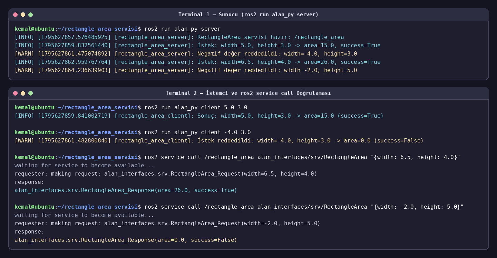

# RectangleArea Servisi (ROS 2)

ROS 2 (`rclpy` ve `ament_cmake`) ile dikdörtgen alanı hesaplayan özel servis arayüzü, sunucu ve istemci paketleri.

## Paket Yapısı

- **`alan_interfaces`**: `RectangleArea.srv` özel servis arayüzünü tanımlar.
- **`alan_py`**: `/rectangle_area` servisini sunan sunucu (`server`) ve komut satırından iki sayı alıp servisi çağıran istemci (`client`) düğümlerini içerir.

## Servis Tanımı (`alan_interfaces/srv/RectangleArea.srv`)

```text
float64 width
float64 height
---
float64 area
bool success
```

> **Bonus:** Yanıta `bool success` alanı eklenmiştir. `width < 0` veya `height < 0` gönderildiğinde sunucu isteği reddeder (`area = 0.0`, `success = False`).

## Derleme

```bash
cd ~/rectangle_area_servisi
source /opt/ros/lyrical/setup.bash
colcon build --packages-select alan_interfaces alan_py
source install/setup.bash
```

*(Not: Sistemde GCC 15 + Binutils 2.42 kaynaklı `.base64` derleyici uyumsuzluğu yaşanıyorsa `CC=gcc-13 CXX=g++-13 colcon build --packages-select alan_interfaces alan_py` komutu kullanılabilir.)*

## Çalıştırma

### 1. Arayüz Kontrolü

```bash
ros2 interface show alan_interfaces/srv/RectangleArea
```

### 2. Sunucuyu Başlatma (Terminal 1)

```bash
source /opt/ros/lyrical/setup.bash
source install/setup.bash
ros2 run alan_py server
```

### 3. İstemci ile Çağırma (Terminal 2)

```bash
source /opt/ros/lyrical/setup.bash
source install/setup.bash

# Pozitif değerler
ros2 run alan_py client 5.0 3.0

# Negatif değer (Bonus testi)
ros2 run alan_py client -4.0 3.0
```

## Doğrulama (`ros2 service call`)

### Pozitif Değerlerle Çağrı

```bash
ros2 service call /rectangle_area alan_interfaces/srv/RectangleArea "{width: 6.5, height: 4.0}"
```

Çıktı:

```text
waiting for service to become available...
requester: making request: alan_interfaces.srv.RectangleArea_Request(width=6.5, height=4.0)

response:
alan_interfaces.srv.RectangleArea_Response(area=26.0, success=True)
```

### Negatif Değerle Çağrı (Bonus Doğrulaması)

```bash
ros2 service call /rectangle_area alan_interfaces/srv/RectangleArea "{width: -2.0, height: 5.0}"
```

Çıktı:

```text
waiting for service to become available...
requester: making request: alan_interfaces.srv.RectangleArea_Request(width=-2.0, height=5.0)

response:
alan_interfaces.srv.RectangleArea_Response(area=0.0, success=False)
```

## Terminal Ekran Görüntüsü


